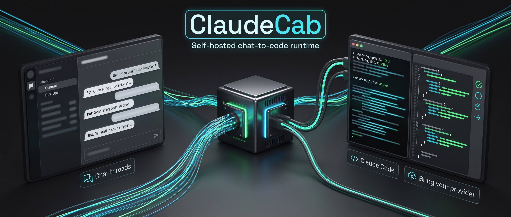

# ClaudeCab



ClaudeCab 是一個 Discord-first runtime，讓使用者在 Discord channel/thread 裡透過 `@anthropic-ai/claude-agent-sdk` / Claude Code 和 agent 對話。

它的定位很窄：

- 讓 Claude Code 訂閱、Anthropic API key，或 Anthropic-compatible provider 可以透過 Discord 使用。
- 把 Discord channel/thread 對話映射成可持續 resume 的 Claude session。
- 讓每個 `agents/<id>/` 都是一個獨立 Claude Code 專案，也就是「目錄即代理」。

```text
Discord channel/thread
  -> Agent Bot
  -> ClaudeCab
  -> Claude Agent SDK / Claude Code
  -> Discord reply
```

## 功能範圍

目前包含：

- 從 `AGENTS_DIR` 載入多個 Discord agents。
- Claude Agent SDK persistent sessions（可恢復的長駐對話）。
- Discord permission / question / exit-plan callbacks。
- idle session cleanup 與 prompt-cache keepalive。
- YAML schedules，可輸出 Discord message/thread。
- SQLite persistence：sessions、conversation、query metrics、schedule thread mapping。
- 可選的 Discord ops 診斷：dashboard、cost report、cache anomaly report。
- 內建 `file-send` MCP tool，讓 Claude Code 可把檔案送回 Discord。
- 預設關閉的小型 admin console，供 operator 設定、驗證、重啟。

目前不包含：

- 公開 Web UI / public dashboard assets。
- Telegram。
- 語音轉文字與本機音效不是核心功能；需要時可透過 opt-in 設定啟用。
- 自主社群發文或 initiative routing。
- 舊 task、budget、activity services。

## 快速開始

完整安裝、Docker、Cloud、DeepSeek / proxy/provider 設定請看 [docs/SETUP.md](docs/SETUP.md)。README 只保留最短路徑。

如果你要把整包交給 AI assistant 協助部署，請讓它先讀 [.claude/skills/claudecab-deploy/SKILL.md](.claude/skills/claudecab-deploy/SKILL.md)。這是 repo 內唯一預期對外公開的 Claude project skill。

需求：

- Node.js 20+
- npm
- Git
- 一個 Discord server
- Discord Developer Portal 裡至少一個 bot
- Claude Code OAuth、Anthropic API key，或 Anthropic-compatible provider key

安裝：

```bash
git clone https://github.com/cablate/ClaudeCrab.git ClaudeCab
cd ClaudeCab
npm install
cp .env.example .env
```

Windows PowerShell：

```powershell
Copy-Item .env.example .env
```

最小設定：

1. 填 `.env`：
   - `DISCORD_ENABLED=true`
   - `DISCORD_MAIN_BOT_TOKEN`
   - `DISCORD_MAIN_BOT_CLIENT_ID`
   - `DISCORD_GUILD_ID`
   - `AGENTS_DIR=./agents`
   - Claude 認證模式需要的 key 或 OAuth
2. 填 `agents/example/agent.json`：
   - `discordBotToken`
   - `discordChannelId`
3. 填 `agents/example/.claude/settings.local.json` 的 `model`。如果使用 DeepSeek / proxy / 第三方 provider，優先填同一份檔案的 `env.ANTHROPIC_API_KEY` 或 `env.ANTHROPIC_AUTH_TOKEN`，以及 `env.ANTHROPIC_BASE_URL`。

驗證：

```bash
npm run setup:check
npm run setup:verify
```

Discord 實連測試會真的送出訊息，token/channel 填好後再執行：

```bash
npm run discord:check -- --agent example
```

啟動：

```bash
npm run dev
```

正式本機啟動（supervisor 管理、自動重啟）：

```bash
npm start
```

`npm start` 跑的是 `start.ts` supervisor，內部以 tsx 直接執行 `src/index.ts`，**不需要先 `npm run build`**。`npm run build` 產生的 `dist/` 只有 Docker 部署會用到。

啟動後到 `discordChannelId` 對應的 channel 發一則文字訊息。Agent Bot 有回覆，才算真的跑通。

## Claude 認證模式

Claude Code 會依照 agent 工作目錄讀取 `.claude/settings.local.json` 與主機認證。常見順序是：

1. agent 的 `.claude/settings.local.json` 裡的 `env.ANTHROPIC_API_KEY` 或 `env.ANTHROPIC_AUTH_TOKEN`
2. `.env` 的 `ANTHROPIC_API_KEY`
3. 主機 Claude Code OAuth，也就是 `claude login`

建議：

| 模式 | 做法 |
|---|---|
| Claude Code 訂閱 / OAuth | 部署機器跑 `claude login`，不要設定 `ANTHROPIC_BASE_URL`。 |
| Anthropic API key | 可放 `.env`，或放 agent `.claude/settings.local.json`。 |
| DeepSeek / proxy / Anthropic-compatible provider | 優先放 agent `.claude/settings.local.json`，使用 provider 需要的 `ANTHROPIC_API_KEY` 或 `ANTHROPIC_AUTH_TOKEN`，避免污染主機 OAuth。 |

## 文件入口

| 文件 | 用途 |
|---|---|
| [docs/SETUP.md](docs/SETUP.md) | 從 clone 到本機/Docker/Cloud 跑起來的完整步驟。 |
| [docs/ARCHITECTURE.md](docs/ARCHITECTURE.md) | 模組邊界、啟動流程、訊息流程。 |
| [docs/LOGGING.md](docs/LOGGING.md) | 查 log、調整 log、排查無回應或排程未觸發。 |
| [docs/SDK_TOUCHPOINTS.md](docs/SDK_TOUCHPOINTS.md) | 動 SDK、CLI、session、query、hook、sub-agent 前必讀。 |
| [docs/CLAUDE-SETTINGS.md](docs/CLAUDE-SETTINGS.md) | agent `.claude/settings.local.json` 設定與官方文件指引。 |
| [docs/OPEN_SOURCE_READINESS.md](docs/OPEN_SOURCE_READINESS.md) | 開源發布前檢查、CI/security/release gate。 |
| [.claude/skills/claudecab-deploy/SKILL.md](.claude/skills/claudecab-deploy/SKILL.md) | 給 AI assistant 部署 ClaudeCab 的 skill 指引。 |
| [AGENTS.md](AGENTS.md) | 本 repo 的 AI agent 治理規範，開工前必讀。 |
| [CONTRIBUTING.md](CONTRIBUTING.md) | 貢獻規則與 PR 前檢查。 |
| [SECURITY.md](SECURITY.md) | 安全回報與部署安全注意事項。 |
| [CODE_OF_CONDUCT.md](CODE_OF_CONDUCT.md) | 公開協作行為準則。 |

## 交給 AI 部署

如果你要把這包交給另一個 AI assistant 架設，直接給它這段：

```text
請先閱讀 AGENTS.md、README.md、docs/SETUP.md、.claude/skills/claudecab-deploy/SKILL.md，然後依照 setup 文件完成 ClaudeCab 部署。不要輸出或提交 secret，不要用 Discord 聊天改設定；設定只走 .env、agents/<id>/agent.json、agents/<id>/.claude/settings.local.json、schedule YAML 或 admin console/local overlay。完成後執行 npm run setup:check、npm run setup:verify；只有我同意時才執行會送出 Discord 訊息的 npm run discord:check。
```

## 常用指令

```bash
npm run setup:check
npm run setup:verify
npm run discord:check -- --agent example
npm run schedule:validate
npm run schedule:check -- agents/example/schedules/example-daily-check.yaml --strict
npm run typecheck
npm run lint
npm run test:run
```

`setup:verify` 不會送 Discord 訊息，且使用隔離 build，不覆寫 production `dist/`。
`discord:check` 會送真實 Discord 測試訊息。

## Repository Hygiene

這個 repository 只應包含 ClaudeCab runtime、公開範例、測試與文件。

不應提交：

- `.env`
- 真實 Discord token / API key / OAuth credential
- 真實 live agent folders
- `data/`
- `logs/`
- `dist/`
- `.codegraph/`
- `.claude/` 裡除了 `.claude/skills/claudecab-deploy/**` 以外的內容
- local agent skills 或私人 Claude Code settings
- generated databases

預設只追蹤 `agents/example`；你的真實 `agents/*` 會被 `.gitignore` 排除。

## License

AGPL-3.0-or-later. See [LICENSE](LICENSE).
