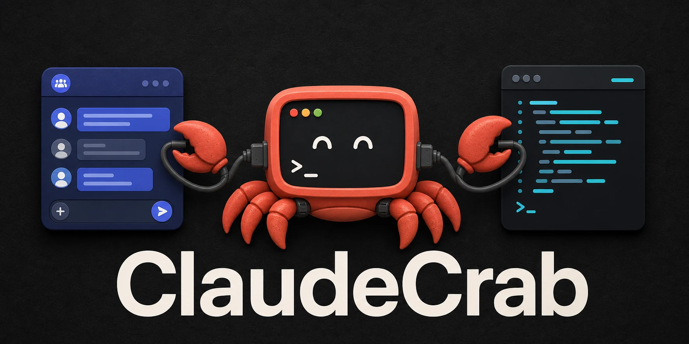

# ClaudeCrab



**把 Claude Code 帶進 Discord。** ClaudeCrab 是一個 self-hosted、Discord-first 的 Claude Agent SDK runtime，讓 Discord channel / thread 成為可持續、可恢復的 agent 對話工作區。

[](https://github.com/cablate/ClaudeCrab/actions/workflows/ci.yml)
[](https://github.com/cablate/ClaudeCrab/actions/workflows/codeql.yml)
[](https://github.com/cablate/ClaudeCrab/actions/workflows/secret-scan.yml)
[](https://github.com/cablate/ClaudeCrab/releases)
[](LICENSE)

```text
Discord channel / thread
        ↓
   ClaudeCrab
        ↓
Claude Agent SDK / Claude Code
        ↓
你的 agent 專案、工具與模型服務
```

## 為什麼是 ClaudeCrab

- **Discord thread 就是長期對話。** 每個 thread 對應可 resume 的 Claude session，不必一直守在終端機前。
- **目錄就是 agent。** 每個 `agents/<id>/` 都是獨立 Claude Code 專案，可擁有自己的 `CLAUDE.md`、`.claude/`、MCP、權限與 provider。
- **使用自己的認證。** 支援 Claude Code OAuth、Anthropic API key，以及 Anthropic-compatible provider / proxy。
- **資料留在自己的主機。** Bot、SQLite、logs、agent workspace 與 secrets 都由 operator 管理。
- **不只轉發文字。** 支援 permission / question / exit-plan 互動、檔案回傳、排程、session cleanup 與可選的管理介面。

適合想把個人或團隊 Claude Code agent 放進 Discord、需要長時間工作流、或要把整包交給 AI assistant 自動部署的人。不適合拿來做公開 SaaS、多租戶控制台，或讓一般 Discord 使用者直接修改系統設定。

## 功能

| 能力 | 用途 |
|---|---|
| 多 agent 載入 | 從 `AGENTS_DIR` 啟動多個獨立 Discord agent。 |
| Persistent sessions | 保存並恢復 Discord thread 對應的 Claude session。 |
| Claude Code 互動 | 在 Discord 處理 permission、question、exit-plan 與中止操作。 |
| YAML schedules | 定時執行 agent，將結果送到 Discord message 或 thread。 |
| SQLite persistence | 保存 session、conversation、query metrics 與 schedule thread mapping。 |
| 資源管理 | idle session cleanup、prompt-cache keepalive、timeout 與 session guard。 |
| 檔案傳送 | 內建 `file-send` MCP tool，讓 agent 把產物送回 Discord。 |
| Operator tools | 可選的 admin console、dashboard、cost 與 cache anomaly 診斷。 |

## 5 分鐘開始

需求：Node.js 20+、npm、Git、一個 Discord server，以及 Claude Code OAuth / Anthropic API key / 相容 provider key 三者之一。

```bash
git clone https://github.com/cablate/ClaudeCrab.git
cd ClaudeCrab
npm install
cp .env.example .env
cp -R agents/example agents/my-agent
```

Windows PowerShell：

```powershell
Copy-Item .env.example .env
Copy-Item agents/example agents/my-agent -Recurse
```

接著只填三個地方：

1. `.env`：Discord 主 Bot、Guild、認證模式與 `AGENTS_DIR`。
2. `agents/my-agent/agent.json`：Agent Bot token 與目標 channel。
3. `agents/my-agent/.claude/settings.local.json`：模型、權限，以及需要時的 provider env。

> 不要直接把 secret 填進 `agents/example`。`agents/my-agent` 這類自訂目錄已被 `.gitignore` 排除。公開或多人 server 請設定 `.env` 的 `ALLOWED_USERS`；留空代表 agent channel 內所有人都能呼叫 Claude。

驗證設定：

```bash
npm run setup:check -- --agent my-agent
npm run setup:verify
```

啟動開發模式：

```bash
npm run dev
```

正式本機啟動使用 supervisor，自動重啟意外退出的 runtime：

```bash
npm start
```

`npm start` 不需要先 build；Docker image 才使用 `dist/`。完整 Discord Portal、OAuth、Docker、Cloud 與 provider 設定請看 [安裝指南](docs/SETUP.md)。

## 認證與模型服務

| 模式 | 設定位置 | 注意事項 |
|---|---|---|
| Claude Code 訂閱 / OAuth | 部署主機執行 `claude auth login` | 不要同時設定 `ANTHROPIC_BASE_URL`。 |
| Anthropic API key | `.env` 或 agent 的 `.claude/settings.local.json` | 多 agent 使用不同 key 時放 agent 目錄。 |
| DeepSeek / proxy / 相容 provider | agent 的 `.claude/settings.local.json` | 設定 provider 需要的 key / token 與 `ANTHROPIC_BASE_URL`，避免污染主機 OAuth。 |

ClaudeCrab 刻意讓 Claude Code 原生讀取 agent 目錄內的 `.claude` 設定。`agent.json` 只保存 Discord 與顯示資訊，不重複管理模型、skills、hooks 或 MCP。

## Docker / Cloud

```bash
docker compose up --build -d
docker compose logs -f claudecab
```

Container 部署請持久化 `/app/data`；使用 OAuth 時也要持久化 `/home/claudecab/.claude`。雲端環境通常以 API key / provider token 比瀏覽器式 OAuth 更容易維運。細節與 headless troubleshooting 見 [docs/SETUP.md](docs/SETUP.md)。

## 交給 AI 部署

Repo 內附一個公開部署 skill：[`.claude/skills/claudecrab-deploy/SKILL.md`](.claude/skills/claudecrab-deploy/SKILL.md)。把下面這段交給能操作終端機的 AI assistant：

```text
請先閱讀 AGENTS.md、README.md、docs/SETUP.md 與 .claude/skills/claudecrab-deploy/SKILL.md，依照文件部署 ClaudeCrab。先複製 agents/example 成新的 agent 目錄，不要把 secret 寫進可追蹤的範例。不要輸出或提交 secret，也不要透過 Discord 聊天修改設定。完成後執行 npm run setup:check -- --agent <id>、npm run setup:verify；只有在我明確同意後，才能執行會送出真實 Discord 訊息的 npm run discord:check。
```

## 安全邊界

- 一般 Discord 使用者不能修改部署設定；設定只走 `.env`、cloud secrets、admin console/local overlay、agent 專案與 schedule YAML。
- Admin console 預設關閉；啟用時預設只綁 `127.0.0.1` 並要求 token。
- `ALLOWED_USERS` 留空代表允許 agent channel 內所有人，shared server 應明確設定 allowlist。
- 不要提交 `.env`、真實 agent 目錄、OAuth credential、logs、SQLite DB 或 `.claude` 私人狀態。
- `npm run discord:check` 會送出真實 Discord 訊息；其他 setup 驗證不會。

安全問題請依 [SECURITY.md](SECURITY.md) 私下回報，不要在公開 issue 貼 token、log 全文或私人 agent 內容。

## 文件

| 文件 | 用途 |
|---|---|
| [安裝與驗證](docs/SETUP.md) | 本機、Windows background、Docker、Cloud、OAuth 與 provider。 |
| [Claude Code 設定](docs/CLAUDE-SETTINGS.md) | `.claude/settings.local.json`、model、permissions、MCP。 |
| [架構](docs/ARCHITECTURE.md) | 啟動、Discord 訊息、session、schedule 與 persistence 流程。 |
| [Logging](docs/LOGGING.md) | 查無回應、認證、排程與 crash。 |
| [SDK Touchpoints](docs/SDK_TOUCHPOINTS.md) | 修改 SDK / CLI / session / stream 前必讀。 |
| [開源發布檢查](docs/OPEN_SOURCE_READINESS.md) | CI、security、release gate 與已知限制。 |
| [貢獻指南](CONTRIBUTING.md) | 開發規則、測試與 PR 要求。 |

## 常用指令

```bash
npm run setup:check -- --agent my-agent
npm run setup:verify
npm run discord:check -- --agent my-agent
npm run schedule:validate
npm run schedule:check -- agents/my-agent/schedules/example-daily-check.yaml --strict
npm run typecheck
npm run lint
npm run test:run
```

## 專案狀態

ClaudeCrab 已有第一個公開 release，但仍是一個需要 operator 自行持有 Discord 與 Claude/provider 認證的 self-hosted 專案。SDK session 層目前仍鎖定經過 patch 與驗證的版本；升級前必須依 [SDK 升級 SOP](docs/sop-sdk-cli-upgrade.md) 做完整 canary，不接受自動大版本升級。

如果 ClaudeCrab 讓你少開一個遠端桌面、少守一個終端機，歡迎 Star、分享實際部署方式，或提交可重現的 issue。

## License

[AGPL-3.0-or-later](LICENSE)。你可以使用、修改與自架；若透過網路提供修改後的服務，請依 AGPL 提供對應原始碼。
