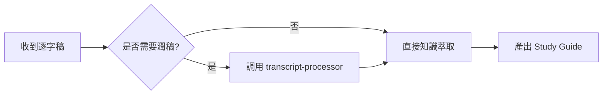

# Study Guide 理論框架

> 為什麼 Study Guide 是逐字稿統整的最佳格式？

---

## Study Guide vs 其他格式

| 格式 | 目的 | 優點 | 缺點 | 適用情境 |
|------|------|------|------|---------|
| **逐字稿** | 完整記錄 | 不遺漏任何細節 | 冗長、難以快速查閱 | 需要精確引用原文 |
| **摘要** | 縮短版本 | 快速閱讀 | 缺乏學習價值、無法行動 | 只需知道「講了什麼」 |
| **筆記** | 個人理解 | 符合個人需求 | 主觀、不適合分享 | 個人複習 |
| **Study Guide** | 學習價值最大化 | 可快速掃描、可深入學習、可直接應用 | 需要深度萃取與重組 | **分享給他人、建立知識資產** |

**為什麼選 Study Guide？**

1. **速度與深度兼具**：Executive Summary 讓人 5 分鐘判斷價值，Key Concepts 讓人深入理解
2. **學習導向**：不只「知道了什麼」，還知道「如何應用」
3. **可驗證**：Review Questions 讓讀者自我檢核
4. **可分享**：結構化、客觀、專業

---

## Study Guide 核心結構

### 1. Executive Summary（核心摘要）

**目的**：讓忙碌的人在 30 秒內判斷「這份文件值不值得讀」

**必備元素**：
- 3-5 個關鍵 takeaways（每個一句話）
- 誰適合讀這份文件（明確定義受眾）
- 預期收穫（讀完後能做什麼）

**寫法原則**：
- ❌ 不要：「這場講座討論了 AI 的應用」（廢話）
- ✅ 要：「學會用 AI 做內容萃取的三個步驟」（具體）

**範例**：

```markdown
## 📌 核心摘要

**關鍵收穫**：
1. AgentSkill 不是 System Prompt——它是有脈絡、可演化的知識體系
2. 給 AI 原則而非規則，讓它能處理未見過的情境
3. 立即可用：三步驟建立你的第一個 AgentSkill

**適合對象**：
- 想讓 AI 協作更穩定的開發者
- 需要建立團隊 AI 使用規範的 PM
- 對 AI 工具設計有興趣的任何人

**預期收穫**：
- 理解 AgentSkill 的底層邏輯
- 學會設計原則導向的 Skill
- 拿到可立即套用的範本
```

---

### 2. Key Concepts（關鍵概念）

**目的**：提煉講座的核心知識點，讓人「真正理解」而非「聽過就忘」

**每個概念必備**：
- **定義**：這個概念是什麼？（一句話）
- **為什麼重要**：解決什麼問題？不懂會怎樣？
- **實際應用**：如何用在實務上？

**識別策略**：
- 講者反覆強調的點
- 講者用對比說明的點（before/after、好壞對比）
- 講者舉例說明的點

**範例**：

```markdown
## 🔑 關鍵概念

### 概念 1：給原則而非規則

**定義**：  
不要告訴 AI「做 A 時用 B 工具」，而是告訴它「為什麼 B 工具適合解決 A 類問題」。

**為什麼重要**：  
規則只適用於見過的情境，原則能讓 AI 推理出如何處理新情境。當你的需求變化時，規則導向的 Skill 會失效，但原則導向的 Skill 會自我適應。

**實際應用**：  
- ❌ 規則：「處理逐字稿時用 Stage 0 + Stage 1 流程」
- ✅ 原則：「保留講者聲音 > 修正閱讀障礙 > 最小侵入」

這樣即使遇到新型態的音源（如多講者 Podcast），AI 也知道如何權衡。
```

---

### 3. 重要範例與案例（Examples & Cases）

**目的**：將抽象概念具象化，讓人「看懂如何做」

**案例結構**：
- **情境**：遇到什麼問題/需求？
- **做法**：採取了什麼行動？
- **結果**：達成什麼效果？

**提取原則**：
- 不要照搬講者的例子，而是轉化成「可複製的模式」
- 如果講者舉了多個類似案例，合併成一個典型範例

**範例**：

```markdown
## 💡 重要範例與案例

### 案例 1：Social-Post-Optimizer Skill 從 0 到成熟（4 小時）

**情境**：  
使用者提供了 Gemini 的對話內容（社群行銷理論），想建立一個能自動分析貼文的 Skill。

**做法**：  
1. 先整理成 Knowledge Base（`knowledge/cases/social-post-marketing-framework.md`）
2. 用 agentskill-expertise 框架設計 Skill（原則導向，v2.0）
3. 立即實戰測試（課程推廣文案 49/60）
4. 使用者採納建議優化（52/60）
5. 測試第二種類型（Build in Public 37→50/60）

**結果**：  
- 4 小時從概念到成熟 Skill
- 兩種完全不同類型都有效（原則通用性驗證）
- 使用者連續兩次採納建議（信任度建立）

**可複製的模式**：  
Knowledge 先行 → agentskill-expertise 設計 → 即時實戰 → 使用者反饋 → 快速迭代
```

---

### 4. Actionable Steps（可執行步驟）

**目的**：把知識轉化成行動，讓人「知道下一步做什麼」

**三層結構**：

| 層次 | 時間 | 特性 | 範例 |
|------|------|------|------|
| 立即可做 | 今天 | 無需準備，馬上開始 | 「打開你最常用的 AI，問它一個問題測試現況」 |
| 一週內 | 本週 | 需要一些準備或學習 | 「選一個常做的任務，設計一個簡單的 Skill」 |
| 長期 | 持續 | 需要養成習慣或文化 | 「每次用 AI 遇到問題，記錄下來作為 Skill 優化依據」 |

**寫法原則**：
- 動詞開頭（不是「可以試試看」而是「試試看」）
- 具體可衡量（不是「多練習」而是「每天寫一個 Skill」）
- 有情境（不是「用 AI」而是「用 AI 處理你今天收到的客服信件」）

**範例**：

```markdown
## 🛠️ 可執行步驟

### 立即可做（今天就能開始）

1. **測試你現在的 AI 使用方式**  
   打開 ChatGPT/Claude，問它一個你常問的問題，觀察回答是否穩定一致。
   
2. **識別一個重複性任務**  
   想一個你每週都要做、且需要 AI 協助的任務（如整理會議記錄、撰寫週報）。

3. **寫下你對 AI 的期待**  
   這個任務你希望 AI 怎麼做？什麼該保留、什麼該改？寫成 3-5 條原則。

### 一週內（需要一些準備）

1. **建立你的第一個 Skill**  
   用剛剛識別的任務，建立一個簡單的 Skill 文件（參考 transcript-processor 範本）。
   
2. **測試並迭代**  
   拿真實資料測試，記錄哪裡不符合預期，調整 Skill 內容。

3. **分享給團隊**  
   如果有效，分享給同事，收集反饋。

### 長期（持續實踐）

1. **建立 Skill 資料庫**  
   每個穩定的 AI 協作流程都 Skill 化，累積組織知識資產。
   
2. **定期 Review**  
   每月檢查 Skill 是否還適用，需求變化時及時更新。

3. **培養原則思維**  
   遇到問題時問「為什麼」而非「怎麼做」，培養設計原則導向 Skill 的能力。
```

---

### 5. Review Questions（自我檢核問題）

**目的**：讓讀者驗證「我真的理解了嗎」

**設計原則**：
- 3-5 題，不要太多
- 不要問「講者說了什麼」（記憶題），要問「如何應用」（理解題）
- 有對比的選擇題 > 開放式問題（easier to self-assess）

**難度層次**：
1. **基礎理解**：核心概念的定義與重要性
2. **應用判斷**：給情境，問該怎麼做
3. **創造延伸**：如何在自己的工作中應用

**範例**：

```markdown
## ❓ 自我檢核問題

### 基礎理解

**Q1：AgentSkill 和 System Prompt 的核心差異是什麼？**

<details>
<summary>參考答案</summary>

System Prompt 是一次性指令，AgentSkill 是有脈絡、可演化的知識體系。

關鍵差異：
- System Prompt：每次都要重新寫，沒有累積
- AgentSkill：可迭代優化，是長期資產
</details>

---

### 應用判斷

**Q2：以下哪個是「原則導向」的 Skill 設計？**

A) 「處理逐字稿時，先用 SRT 解析，再用 opencc 轉換」  
B) 「保留講者聲音 > 修正閱讀障礙 > 最小侵入」  
C) 「使用 transcript-processor 工具處理所有音源」

<details>
<summary>參考答案</summary>

**B**

解析：
- A 是規則（具體步驟），只適用於 SRT 格式
- C 是工具指定，限制了彈性
- B 是原則，能指導各種情境的判斷
</details>

---

### 創造延伸

**Q3：想想你的工作，有哪一個重複性任務適合建立 AgentSkill？為什麼？**

提示：
- 是否每週都要做？
- 是否需要 AI 協助？
- 目前 AI 的輸出是否不穩定？

<details>
<summary>思考方向</summary>

好的候選任務特徵：
1. 高重複性（每週 2+ 次）
2. 有品質要求（不能隨便做）
3. 目前靠「每次重新下 prompt」來做

範例：
- 整理會議記錄 → transcript-processor
- 分析社群貼文 → social-post-optimizer
- 撰寫技術文件 → 可建立 tech-doc-writer
</details>
```

---

### 6. 延伸資源（Further Resources）

**目的**：提供下一步學習的路徑

**分類**：
- 工具（Tools）：直接可用的軟體/服務
- 文章（Articles）：深入閱讀的參考
- 課程（Courses）：系統性學習
- 社群（Communities）：討論與交流

**範例**：

```markdown
## 📚 延伸資源

### 工具（Tools）

- **[雅婷逐字稿](https://asr.yating.tw/)**：台語/中文逐字稿轉換（免費）
- **[NotebookLM](https://notebooklm.google.com/)**：Google 的知識萃取工具
- **[Serena MCP](https://github.com/oraios/serena)**：程式碼的語意操作工具

### 文章（Articles）

- [《知識萃取工具包》專訪](https://readingoutpost.com/knowledge-extraction/)：喊涵談如何 4 小時萃取專業知識
- [用 ChatGPT 將逐字稿轉成完美文章](https://www.playpcesor.com/2023/03/chatgpt-note.html)：電腦玩物的實戰技巧

### 課程（Courses）

- （待補充：如果有相關課程）

### 社群（Communities）

- （待補充：如果有相關社群）
```

---

## 格式規範

### Markdown 元素使用

| 元素 | 用途 | 範例 |
|------|------|------|
| `#` | 文件標題 | `# AgentSkill 講座學習指南` |
| `##` | 主區塊 | `## 🔑 關鍵概念` |
| `###` | 子標題 | `### 概念 1：給原則而非規則` |
| `**粗體**` | 重要詞彙、關鍵結論 | `**定義**：` |
| `` `Code` `` | 工具名稱、指令 | `` `transcript-processor` `` |
| `> 引言` | 講者金句、重要觀點 | `> 「AI 是協作者，不是替代品」` |
| `- 列表` | 要點、步驟 | `- 立即可做：...` |
| `表格` | 對比、分類 | 見上方各處範例 |
| Emoji | 區塊標記（增加可讀性） | `📌 🔑 💡 🛠️ ❓ 📚` |

### Emoji 使用規範

| Emoji | 用途 |
|-------|------|
| 📌 | Executive Summary |
| 🔑 | Key Concepts |
| 💡 | Examples & Cases |
| 🛠️ | Actionable Steps |
| ❓ | Review Questions |
| 📚 | Further Resources |
| ✅ | 正確做法、優點 |
| ❌ | 錯誤做法、缺點 |
| ⚠️ | 注意事項、警告 |

---

## 長度指引

| 區塊 | 建議長度 | 說明 |
|------|---------|------|
| Executive Summary | 100-200 字 | 30 秒可讀完 |
| 每個 Key Concept | 150-300 字 | 1 分鐘理解一個概念 |
| 每個 Example | 200-400 字 | 完整呈現情境→做法→結果 |
| Actionable Steps | 300-500 字 | 三層結構，每層 2-3 個步驟 |
| Review Questions | 3-5 題 | 不要太多，重質不重量 |
| Further Resources | 5-10 項 | 精選即可，不要堆砌 |

**總長度**：1500-3000 字（閱讀時間 10-15 分鐘）

---

## 視覺化元素建議

### 流程圖（Process Diagrams）

適用：步驟型內容、決策流程

**工具**：Mermaid（Markdown 原生支援）

**範例**：

```markdown
## 工作流程


```

### 對照表（Comparison Tables）

適用：Before/After、優劣對比、選項比較

**範例**：

```markdown
| Before（聽講座前） | After（讀完 Study Guide 後） |
|------------------|---------------------------|
| 不知道 AgentSkill 是什麼 | 理解 AgentSkill 的核心價值 |
| 每次都重新下 prompt | 建立可重複使用的 Skill |
| AI 輸出不穩定 | 有原則指導，品質一致 |
```

### Checklist

適用：可執行步驟、品質檢查

**範例**：

```markdown
## 建立 Skill 檢查清單

- [ ] 識別了重複性任務
- [ ] 寫下 3-5 條核心原則
- [ ] 測試了真實資料
- [ ] 記錄了失敗案例
- [ ] 分享給至少一個同事
```

---

## 進階技巧

### 時間標記（如果有影片/錄音）

幫助讀者回查原始內容：

```markdown
### 概念 2：診斷先於處方 [15:23]

**定義**：  
不要一開始就給解法，而是先理解問題本質。

> 💡 這段講者用醫生看病的比喻說明，值得回看原影片：[15:23-17:45]
```

### 引言金句

提煉講者精華語錄：

```markdown
## 🔑 關鍵概念

> 💬 「Skill 不是規則清單，而是價值觀的體現。」  
> — 講者，於 23:15

### 概念 3：價值觀驅動設計
...
```

### Before/After 對比區塊

放在 Executive Summary 開頭，增加吸引力：

```markdown
## 📌 核心摘要

### 🎯 這份指南能為你帶來什麼改變？

| 學習前 | 學習後 |
|-------|-------|
| AI 回答不穩定，每次都要調整 prompt | 建立 Skill，AI 行為一致可預測 |
| 知識散落在對話記錄中，無法累積 | 知識結構化，成為可演化的資產 |
| 只知道「怎麼用」，不知道「為什麼」 | 理解底層原則，能設計新 Skill |
```

---

## 品質檢查清單

完成 Study Guide 後，用這份清單自檢：

### 結構完整性

- [ ] 有 Executive Summary（3-5 個 takeaways）
- [ ] 有 Key Concepts（至少 2 個概念）
- [ ] 有 Actionable Steps（三層結構）
- [ ] 有 Review Questions（3-5 題）

### 內容品質

- [ ] Executive Summary 能在 30 秒內讀完
- [ ] 每個概念都有：定義 + 重要性 + 應用
- [ ] Actionable Steps 具體可執行（動詞開頭）
- [ ] Review Questions 能驗證理解（非記憶題）

### 視覺友善

- [ ] 使用了適當的 Emoji 標記
- [ ] 重要內容有粗體標示
- [ ] 有適當的表格或列表
- [ ] 段落不會太長（3-5 行一段）

### 價值感

- [ ] 讀者能在 5 分鐘內掌握核心價值
- [ ] 讀者知道「下一步做什麼」
- [ ] 讀者能自我驗證學習成效
- [ ] 讀者想要分享給他人

如果以上都勾選了，恭喜你產出了一份「高於全球平均水準」的 Study Guide！
