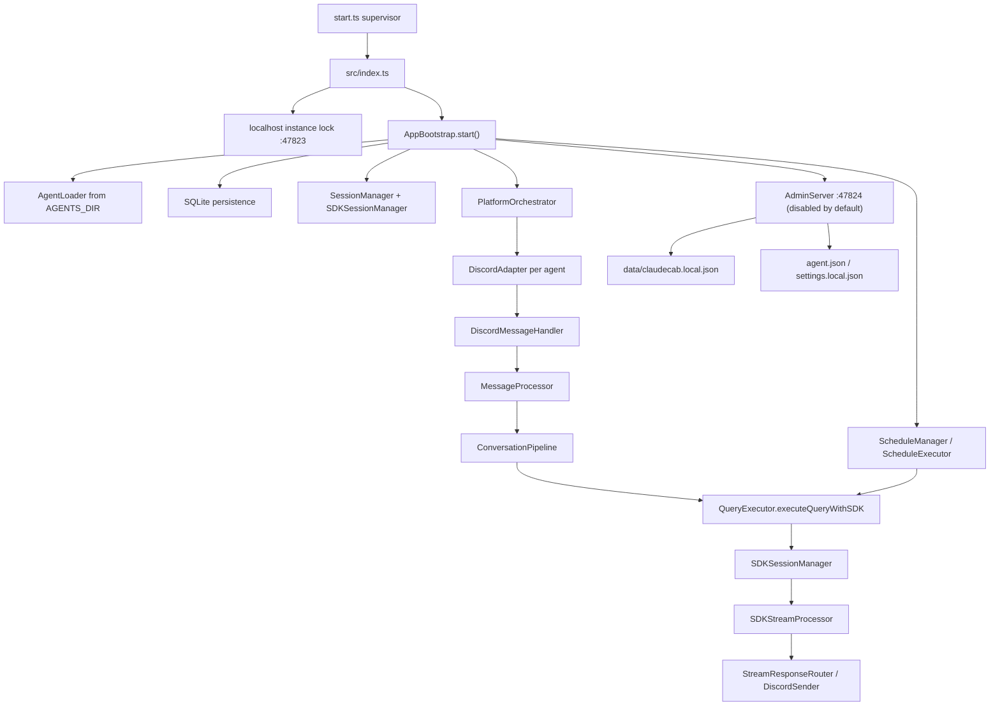

# ClaudeCab Architecture

Last updated: 2026-07-06

This document is the current architecture entry point. Legacy planning notes that mentioned removed systems are intentionally excluded from the public repository.

## Current Boundary

ClaudeCab is a Discord-first Claude Agent SDK runtime.

The live product surface is:

- Discord agent bots loaded from `AGENTS_DIR`.
- Claude Agent SDK persistent sessions（可恢復的長駐對話）.
- Discord slash commands.
- YAML schedules that can continue in Discord threads.
- SQLite persistence for sessions, conversations, query metrics, rate-limit snapshots, and schedule executions.
- Prompt-cache keepalive and context telemetry.
- Built-in MCP file sending back to Discord.
- Disabled-by-default operator admin console for setup, config, validation, and restart.

Optional operator surfaces:

- Discord ops diagnostics: dashboard, cost report, and cache anomaly report.
- Speech-to-text and local sound notifications.

Not current product surfaces:

- Telegram.
- Public WebUI.
- Autonomous social or initiative routing.
- Old BudgetService, TaskService, TTSService, ActivityReporter, or task-sync services.
- Legacy policy injection and prompt decoration layers.

## Runtime Layout



## Key Flows

### Startup

1. `start.ts` supervises the child process, writes `claudecab.runtime.json`, and restarts crashes with backoff.
2. `src/index.ts` loads `.env`, acquires the instance lock, installs crash handlers, and starts `AppBootstrap`.
3. `AppBootstrap` wires security, audit, agent loading, persistence, session managers, message processing, adapters, schedule system, and Discord system services.
4. `PlatformOrchestrator.startAll()` starts Discord adapters for loaded agents with `discordBotToken` and `discordChannelId`.
5. When `ADMIN_CONSOLE_ENABLED=true`, `AdminServer` starts on the configured host/port and exposes token-protected setup/config/restart APIs.

### Message Processing

1. `DiscordAdapter` receives a Discord message.
2. `DiscordMessageHandler` converts it to a unified message.
3. `MessageProcessor` creates correlation context and calls `ConversationPipeline`.
4. `ConversationPipeline` handles deduplication, session creation, per-session locking, session guard, and state transitions.
5. `QueryExecutor` builds MCP tools, interaction bridges, SDK options, usage reporting, persistence, and final delivery.
6. `SDKSessionManager` executes through a persistent Claude SDK session.
7. `SDKStreamProcessor` consumes SDK stream events and routes assistant text, tool events, hook events, sub-agent events, usage, and context telemetry.

### Schedules

1. `ScheduleLoader` loads `AGENTS_DIR/<agent>/schedules/*.yaml`.
2. `ScheduleManager` registers enabled schedules through `CronScheduler`.
3. `ScheduleExecutor` runs scheduled prompts and delivers output to Discord message/thread targets.
4. Schedule-created threads can resume through `ScheduleThreadMap` and persisted session rows.

## Runtime Profiles

Live agent folders are local runtime configuration and are intentionally ignored by git.

Live profiles are external:

- `AGENTS_DIR/<agent-id>/agent.json`
- `AGENTS_DIR/<agent-id>/.claude/settings.local.json`
- `AGENTS_DIR/<agent-id>/.mcp.json`
- `AGENTS_DIR/<agent-id>/schedules/*.yaml`
- `CLAUDECAB_LOCAL_CONFIG_PATH` (default `./data/claudecab.local.json`) for admin-console global overrides.

Directories whose names start with `_` are treated as disabled/template agent directories and are not loaded.

## Complexity Hotspots

The largest and riskiest modules are:

- `src/core/query/QueryExecutor.ts`: cross-cutting query orchestration.
- `src/core/query/SDKStreamProcessor.ts`: SDK stream parsing mixed with side effects.
- `src/adapters/DiscordAdapter.ts`: broad Discord facade.
- `src/core/orchestrator/AgentLoader.ts`: profile, workspace, prompt, hooks, and MCP loading.

Refactor these only after characterization tests are in place.

Current characterization coverage started on 2026-06-19:

- `AgentLoader` scan/load behavior.
- `ScheduleLoader` schema and canonical ID behavior.
- Built-in MCP setup for the file-send tool.
- `SessionGuard` prompt decisions and repeated length-guard suppression.

## Quality Commands

Use the commands that actually exist in `package.json`:

```bash
npm run typecheck
npm run test:run
npm run lint
npm run build
```

There is currently no `npm run quality-gate` script.
