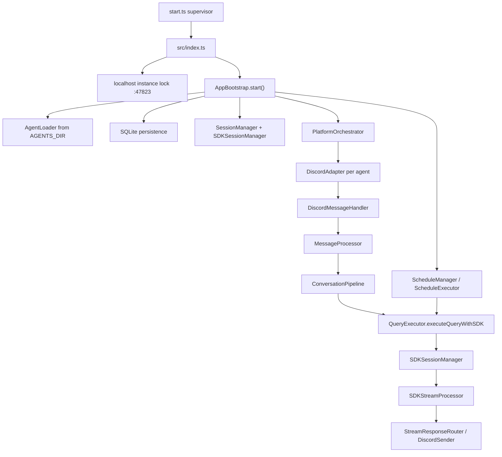

# ClaudeCab Architecture

Last updated: 2026-06-19

This document is the current architecture entry point. Older architecture notes that mention Telegram, WebUI, BudgetService, TaskService, TTSService, or `npm run quality-gate` have been archived under `docs/archive/`.

## Current Boundary

ClaudeCab is a Discord-first Claude Agent SDK runtime.

The live product surface is:

- Discord agent bots loaded from `AGENTS_DIR`.
- Claude Agent SDK V2 persistent sessions.
- Discord slash commands and operational dashboards.
- YAML schedules that can continue in Discord threads.
- SQLite persistence for sessions, conversations, query metrics, rate-limit snapshots, and schedule executions.
- Prompt-cache keepalive, context telemetry, cost reporting, and cache anomaly diagnostics.
- Built-in MCP tools for file sending and workspace validation.

Not current product surfaces:

- Telegram.
- WebUI.
- Autonomous social or initiative routing.
- Old BudgetService, TaskService, TTSService, ActivityReporter, or task-sync services.

## Runtime Layout



## Key Flows

### Startup

1. `start.ts` supervises the child process, writes `claudecab.runtime.json`, and restarts crashes with backoff.
2. `src/index.ts` loads `.env`, acquires the instance lock, installs crash handlers, and starts `AppBootstrap`.
3. `AppBootstrap` wires security, audit, agent loading, persistence, session managers, message processing, adapters, schedule system, and Discord system services.
4. `PlatformOrchestrator.startAll()` starts Discord adapters for loaded agents with `discordBotToken` and `discordChannelId`.

### Message Processing

1. `DiscordAdapter` receives a Discord message.
2. `DiscordMessageHandler` converts it to a unified message.
3. `MessageProcessor` creates correlation context and calls `ConversationPipeline`.
4. `ConversationPipeline` handles deduplication, session creation, per-session locking, session guard, and state transitions.
5. `QueryExecutor` builds prompt decoration, MCP tools, interaction bridges, SDK options, usage reporting, persistence, and final delivery.
6. `SDKSessionManager` executes through a persistent Claude SDK session.
7. `SDKStreamProcessor` consumes SDK stream events and routes assistant text, tool events, hook events, sub-agent events, usage, and context telemetry.

### Schedules

1. `ScheduleLoader` loads `AGENTS_DIR/<agent>/schedules/*.yaml`.
2. `ScheduleManager` registers enabled schedules through `CronScheduler`.
3. `ScheduleExecutor` runs scheduled prompts and delivers output to Discord message/thread targets.
4. Schedule-created threads can resume through `ScheduleThreadMap` and persisted session rows.

## Runtime Profiles

The repo-local `agents/example/*` tree is sanitized reference material only.

Live profiles are external:

- `AGENTS_DIR/<agent-id>/agent.json`
- `AGENTS_DIR/<agent-id>/.claude/settings.local.json`
- `AGENTS_DIR/<agent-id>/.mcp.json`
- `AGENTS_DIR/<agent-id>/schedules/*.yaml`
- `AGENTS_DIR/_foundation/...`

Foundation runtime assets resolve through `AGENTS_DIR/_foundation`, not repo-local `agents/_foundation`.

## Complexity Hotspots

The largest and riskiest modules are:

- `src/core/query/QueryExecutor.ts`: cross-cutting query orchestration.
- `src/core/query/SDKStreamProcessor.ts`: SDK stream parsing mixed with side effects.
- `src/adapters/DiscordAdapter.ts`: broad Discord facade.
- `src/core/orchestrator/AgentLoader.ts`: profile, workspace, prompt, MCP, and runtime asset loading.

Refactor these only after characterization tests are in place.

Current characterization coverage started on 2026-06-19:

- Foundation runtime asset resolution from `AGENTS_DIR/_foundation`.
- `AgentLoader` scan/load behavior.
- `ScheduleLoader` schema and canonical ID behavior.
- Built-in MCP setup for file-send and validator tools.
- `SessionGuard` prompt decisions and repeated length-guard suppression.

## Quality Commands

Use the commands that actually exist in `package.json`:

```bash
npm run typecheck
npm run test:run
npm run lint
npm run build
```

There is currently no `npm run quality-gate` script.

## Current Baseline Report

For the detailed 2026-06-19 architecture and quality review, see:

[`docs/current-architecture-review-2026-06-19.md`](current-architecture-review-2026-06-19.md)
