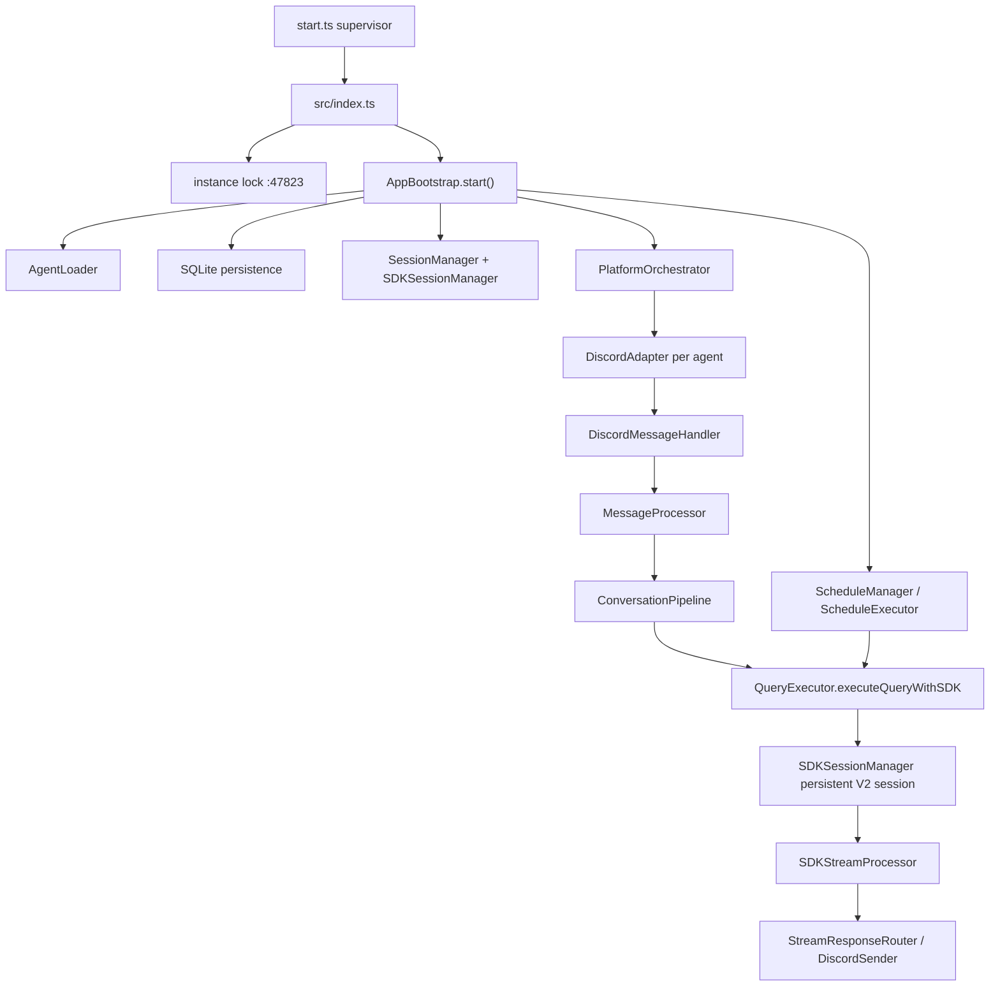

# ClaudeCab Current Architecture Review

Date: 2026-06-19

Scope: current repo state after agent-profile cleanup, `src/`, `start.ts`, package scripts, runtime logs, docs drift, and CodeGraph-assisted call-flow checks.

CodeGraph baseline: forced rebuild completed on 2026-06-19 after the current slimming pass. Status result: 123 indexed files, 1,875 nodes, 4,430 edges. The remaining CodeGraph read errors are deleted files from the slimming work.

## Executive Verdict

ClaudeCab is not currently a broad multi-agent product platform. It is a Discord-first Claude Agent SDK runtime with a substantial operational shell.

The user's concern is valid: the visible feature surface is modest relative to the code volume. The size is not mainly from many user-facing capabilities. It is from hardening a narrow set of capabilities:

- Discord message delivery, thread handling, interactions, slash commands, dashboards, and reports.
- Persistent Claude Agent SDK V2 sessions, resume behavior, stream parsing, cancellation, and fail-closed retry rules.
- Prompt-cache keepalive, context telemetry, rate-limit snapshots, usage cards, anomaly diagnostics, and cost reporting.
- YAML schedule execution and schedule-created Discord thread continuation.
- SQLite persistence around sessions, conversations, query metrics, rate limits, and schedule executions.
- Agent profile loading from `AGENTS_DIR`, including prompts, `.claude` settings, MCP config, and foundation runtime assets.

This makes the project feel larger than its product feature count because the hard part is runtime continuity and observability, not breadth of features.

## Current Runtime Boundary

Active product boundary:

- Discord is the only live platform adapter.
- Claude Agent SDK is the only LLM execution engine.
- Agent definitions are runtime configuration under `AGENTS_DIR`, not product code.
- `agents/example/*` inside this repo is now sanitized reference material, not active runtime config.
- The running app currently uses `.env` `AGENTS_DIR=D:\_CabLate_Agents`.

Important cleanup correction:

- Runtime foundation assets now resolve through `AGENTS_DIR/_foundation`, not repo-local `agents/_foundation`.
- This keeps repo-local `agents/` clean for code review while allowing the live bot to run from external profiles.

## Architecture Map

### Startup Flow

1. `start.ts` supervises `src/index.ts`, writes `claudecab.runtime.json`, restarts child processes, and separates supervisor logs from app logs.
2. `src/index.ts` loads `.env`, acquires the localhost instance lock on `127.0.0.1:47823`, registers crash handlers, and starts `AppBootstrap`.
3. `AppBootstrap.start()` wires security, audit, agents, persistence, sessions, message processing, platform adapters, schedules, and Discord system services.
4. `PlatformOrchestrator.startAll()` starts one Discord adapter per loaded agent that has both `discordBotToken` and `discordChannelId`.

### Message Flow

CodeGraph trace confirmed:

`MessageProcessor.processConversationRequest()` -> `processMessage()` -> `ConversationPipeline.run()` -> `ConversationPipeline.runLocked()` -> `executeQueryWithSDK()`

Runtime steps:

1. `DiscordAdapter` receives a Discord message.
2. `DiscordMessageHandler` converts it into a unified message and metadata.
3. `MessageProcessor` wraps it in correlation logging context.
4. `ConversationPipeline` handles platform validation, effective user ID, deduplication, session creation, locking, session guard, state transitions, and error delivery.
5. `QueryExecutor` handles prompt decoration, MCP setup, Discord typing, status/sub-agent/hook managers, permission/question bridges, SDK call options, usage reporting, persistence, final response delivery, and cleanup.
6. `SDKSessionManager` owns persistent SDK session lifecycle.
7. `SDKStreamProcessor` consumes SDK stream events and emits user-visible status, tool, hook, usage, cache, and final response effects.

### Schedule Flow

1. `ScheduleManager` loads YAML schedules from active agent folders under `AGENTS_DIR`.
2. `ScheduleLoader` validates schedules with Zod schemas.
3. `CronScheduler` registers enabled schedules.
4. `ScheduleExecutor` runs schedule prompts through SDK managers and creates or updates Discord outputs.
5. `ScheduleThreadMap` plus session DB lookup support continuation from schedule-created Discord threads.

Live schedule correction: `threads-daily-analytics.yaml` under the active `AGENTS_DIR` was updated on 2026-06-19 to use `output.mode: message` with `delivery: summary`. The schedule prompt still writes its report file; the schedule schema now receives a valid Discord delivery mode.

### Persistence

SQLite persistence currently includes:

- `sessions`
- `conversations`
- `metadata`
- `schedule_executions`
- `query_metrics`
- `rate_limit_snapshots`

## Functional Inventory

Actually active:

- Discord bot per configured agent.
- Discord slash commands: `help`, `status`, `reset`, `model`, `cost`, `stop`, `close`, `sync`, `restart`, `ctx`, `cache`, `sessions`.
- Message-to-Claude conversation flow.
- Persistent V2 SDK sessions with resume and fail-closed duplicate-query protection.
- Optional ephemeral session mode.
- Session guard based on context size and cache age.
- Context usage telemetry.
- Prompt-cache keepalive.
- Cache anomaly detection and reporting.
- Token/cost/rate-limit metrics.
- Discord dashboard, cost report, cache anomaly report.
- YAML schedule execution.
- Schedule-created thread continuation.
- Optional Groq STT.
- Built-in MCP servers for file send and workspace validation.
- Runtime hook prompt decoration and foundation subagents from `AGENTS_DIR/_foundation`.

Not active as current product surface:

- Telegram.
- WebUI.
- Autonomous social/initiative routing.
- Autonomous delegation as a product surface.
- Old BudgetService/TaskService/TTSService/ActivityReporter services referenced by stale docs.

## Size Profile

Measured TypeScript under `src/`:

| Area | Files | Lines | Role |
|---|---:|---:|---|
| `core/` | 44 | 10,571 | SDK, session, query, keepalive, orchestrator internals |
| `adapters/` | 21 | 4,274 | Discord adapter, commands, sender, dashboard/reporting |
| `persistence/` | 8 | 1,685 | SQLite schema, migrations, repositories |
| `schedule/` | 9 | 1,590 | YAML schedules, cron, execution, notifications |
| `utils/` | 10 | 1,540 | logging, audit, security, retry, attachments |
| `types/` | 8 | 777 | shared type surface |
| `src root` | 5 | 733 | bootstrap/config/constants/MCP setup |
| `tools/` | 3 | 375 | built-in MCP tools |
| `conversation/` | 2 | 292 | conversation pipeline boundary |
| `services/` | 2 | 179 | OAuth usage + keepalive ROI |
| **Total** | **112** | **22,016** |  |

Largest files:

| File | Lines | Why it is large |
|---|---:|---|
| `src/core/query/SDKStreamProcessor.ts` | 767 | SDK stream parsing, stale stream handling, usage/rate-limit/cache/context/sub-agent effects |
| `src/core/session/SessionManager.ts` | 712 | user session lifecycle, locks, restore, processed message IDs, persistence sync |
| `src/core/keepalive/SDKKeepaliveManager.ts` | 706 | prompt-cache ping loop, diagnostics, anomaly state |
| `src/core/session/SDKSessionManager.ts` | 673 | persistent SDK process lifecycle, eviction, keepalive, cancellation |
| `src/core/orchestrator/AgentLoader.ts` | 662 | agent config, prompts, MCP config, settings sync, global rules |
| `src/core/query/QueryExecutor.ts` | 630 | cross-cutting query orchestration |
| `src/adapters/DiscordAdapter.ts` | 553 | Discord client lifecycle, receive/send/thread/file/prompt behavior |
| `src/core/interaction/InteractionHandler.ts` | 476 | SDK hook interaction bridge and Discord prompt resolver registry |
| `src/core/session/SDKSessionFactory.ts` | 459 | SDK session construction and process setup |
| `src/adapters/BaseAdapter.ts` | 450 | shared adapter send/receive contracts and message handler registration |

Interpretation:

- The biggest files are infrastructure, not product features.
- The current user-facing surface is mostly Discord chat plus operational commands.
- The codebase grew around keeping expensive SDK sessions alive and observable.

## CodeGraph Findings

CodeGraph is useful here because the real complexity is call flow, not file count.

Confirmed central path:

`processConversationRequest` -> `ConversationPipeline.run` -> `runLocked` -> `executeQueryWithSDK` -> `SDKSessionManager.executeQuery` -> `SDKStreamProcessor.processStream`

High-centrality knots:

- `QueryExecutor`: combines prompt decoration, MCP setup, interaction bridges, SDK dispatch, retry policy, persistence, usage cards, anomaly reporting, and final delivery.
- `SDKStreamProcessor`: combines SDK protocol parsing with user-facing side effects and telemetry extraction.
- `DiscordAdapter`: still acts as a broad facade for receive, send, thread, file, interaction, and lifecycle concerns.
- `AgentLoader`: combines runtime profile loading, workspace assumptions, prompt loading, MCP server parsing, model sync, and global rule injection.

These are the files where the project "feels big."

## Quality State

Verified on 2026-06-19 after the current slimming pass:

- `npm run typecheck`: pass.
- `npm run test:run`: pass, 5 test files / 12 tests.
- `npm run lint`: pass with 0 warnings.
- `npm run build`: pass.
- Characterization tests now cover foundation runtime paths, `AgentLoader`, `ScheduleLoader`, built-in MCP setup, and `SessionGuard`.

Pattern scan:

- `as any`: 3 occurrences.
- `as unknown as`: 4 occurrences.
- `eslint-disable`: 22 occurrences.
- `catch {}` style best-effort blocks: 56 occurrences.
- `catch (error)` blocks: 61 occurrences.

These are not automatically defects, but they mark the places where SDK/runtime uncertainty has leaked into application code.

## Architectural Risks

### 1. QueryExecutor Is Too Cross-Cutting

`QueryExecutor` is the main coordination knot. It currently knows about:

- sessions,
- agents,
- prompt decoration,
- MCP tools,
- Discord typing,
- status/sub-agent/hook managers,
- interaction permission bridges,
- SDK retry/fail-closed rules,
- schedule continuation,
- metrics,
- persistence,
- usage cards,
- cache anomaly reports,
- final response delivery.

This makes small behavior changes risky because they can accidentally affect delivery, persistence, retry, or billing telemetry.

### 2. SDKStreamProcessor Mixes Protocol Parsing and Product Effects

`SDKStreamProcessor` parses SDK events, tracks stale streams, handles tool IDs, extracts usage/model data, records rate-limit snapshots, analyzes cache/context behavior, and fires user-visible callbacks.

This should be split into pure classification/extraction helpers plus a smaller effectful loop. It is currently hard to test and hard to safely change.

### 3. DiscordAdapter Remains a Broad Facade

Some extraction already happened (`DiscordSender`, `DiscordMessageHandler`, commands/services), but `DiscordAdapter` still owns too many responsibilities:

- Discord client lifecycle.
- channel/thread lookup.
- message receiving.
- send APIs.
- file delivery.
- interactive prompts.
- task/schedule thread resolver state.
- rate limiting.

If Discord remains the only product platform, a generic adapter abstraction may be adding more ceremony than value.

### 4. AgentLoader Conflates Profile, Workspace, and Runtime Assets

`AgentLoader` treats an agent directory as:

- product profile config,
- prompt source,
- `.claude` settings source,
- MCP config source,
- schedule location,
- workspace path,
- upload/output target,
- and previously a place where skills/knowledge could pollute code review.

The recent cleanup reduced repo-local pollution, but the architectural contract is still broad.

### 5. Stale Documentation Can Mislead Refactors

`docs/ARCHITECTURE.md` still references removed or stale surfaces:

- `BudgetService`
- `TaskService`
- `TTSService`
- `ActivityRepository`
- `DiscordActivityReporter`
- `DiscordTaskSync`
- `npm run quality-gate`
- Telegram/WebUI/social/initiative/delegation scans as if they are current guardrails

This doc should either be rewritten from this review or moved under archive.

### 6. Runtime Observability Is Good After Startup, Weak Before Logger Init

The app has strong pino JSON logging once it starts. The recent no-log startup failure showed a weak spot: module-import-time synchronous file reads can crash before app logs become useful.

The immediate `AGENTS_DIR/_foundation` fix removed that specific crash. The broader lesson is to avoid heavy synchronous runtime reads at module import time unless the supervisor captures the failure path clearly.

## Positive Signals

- TypeScript strict mode is enabled.
- Zod is used for agent and schedule schemas.
- The supervisor has runtime state, PID file, control file, and backoff behavior.
- The instance lock prevents duplicate Discord workers.
- App logs include correlation context.
- Persistence is repository-based rather than raw SQL scattered everywhere.
- Schedule schema is explicit and fails invalid configs without taking down the app.
- The current critical startup bug was fixed by separating runtime profile assets from repo-local example agents.

## Recommended Work Order

### P0: Make The Current Boundary Official

Status: completed on 2026-06-19.

1. `docs/ARCHITECTURE.md` was rewritten as the current entry point.
2. The old broad-platform architecture document was moved to `docs/archive/ARCHITECTURE.legacy-2026-06-19.md`.
3. The current boundary is now stated as Discord + Claude Agent SDK runtime + schedules + observability.
4. Stale current-surface references to Telegram, WebUI, removed services, and missing `quality-gate` were removed from the active architecture entry point.

### P1: Fix The Live Schedule Error

Status: completed on 2026-06-19.

`threads-daily-analytics.yaml` under the active `AGENTS_DIR` now uses `output.mode: message` and `delivery: summary`. This was runtime noise rather than a code architecture problem, but fixing it makes schedule validation trustworthy again.

### P2: Add Characterization Tests Before Refactor

Status: started on 2026-06-19.

The code is not test-protected enough for aggressive cleanup. Add narrow tests first:

- Done: `AgentLoader.scanAgents()` and ignored/example/foundation directory behavior.
- Done: `AgentLoader.loadAgent()` model sync and `.mcp.json` loading.
- Done: `McpToolSetup.buildMcpSetup()`.
- Done: `ScheduleLoader` valid/invalid schema cases and canonical IDs.
- Done: `SessionGuard` continue/switch/timeout behavior plus repeated length-guard suppression.
- `ConversationPipeline` dedup, lock, session state, and error paths.
- Pure SDK stream classification fixtures extracted from `SDKStreamProcessor`.
- Query fail-closed behavior around resume errors and disabled fallback.

### P3: Split QueryExecutor Into Smaller Units

Recommended extraction sequence:

1. `QueryRuntimeContextBuilder`
2. `QueryMcpConfigurator`
3. `QueryInteractionFactory`
4. `QuerySdkDispatcher`
5. `QueryPersistenceWriter`
6. `QueryUsageReporter`

Do this only after P2 starts; otherwise the risk is high.

### P4: Split SDKStreamProcessor

Extract pure helpers first:

- `classifySdkMessage`
- `extractUsageSnapshot`
- `extractToolEvent`
- `extractContextUsage`
- `isStaleResumeMessage`
- `buildStreamResult`

Then keep `processStream()` as the effectful loop that calls tested helpers.

### P5: Make Agent Profiles A Formal Runtime Boundary

Use a clearer model:

- repo `agents/example/*` = sanitized examples only,
- external `AGENTS_DIR/<agent-id>` = live runtime profiles,
- `AGENTS_DIR/_foundation` = shared runtime foundation assets,
- generated uploads/logs/memory/output stay outside source-controlled product code.

This avoids future confusion between code architecture and agent memory/skill/workspace contents.

### P6: Re-evaluate The Generic Platform Layer

If Discord remains the only supported platform, keep only a thin interface for testability. Do not preserve Telegram/WebUI-era abstractions without an active product requirement.

## Bottom Line

ClaudeCab can currently do a useful but narrow set of things:

- run Discord agents,
- preserve expensive Claude SDK sessions,
- stream and display SDK/tool/sub-agent activity,
- track context/cache/cost/rate limits,
- run scheduled prompts,
- support operational Discord commands.

The codebase is large because it is acting as a reliability wrapper around Claude Code/Agent SDK in Discord, not because it has a broad product surface.

The pragmatic next move is not to add more features. It is to make the current product boundary official, add characterization tests around the fragile paths, and then reduce the four complexity knots: `QueryExecutor`, `SDKStreamProcessor`, `DiscordAdapter`, and `AgentLoader`.
