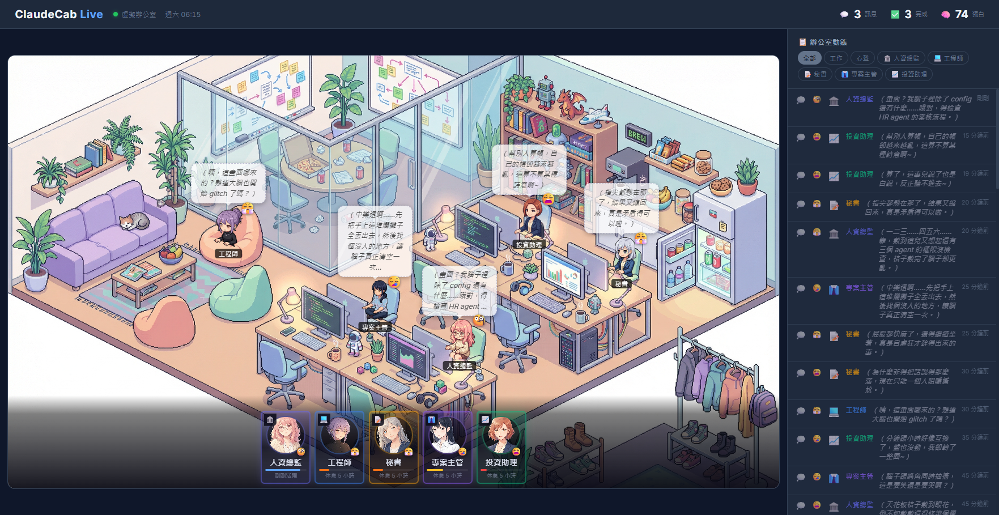

# ClaudeCab Live 現況全面審查

> 建立時間：2026-02-14
> 目的：盤點現有功能、架構、UI 元素，找出可擴展點與潛在組合

---

## 截圖記錄



---

## UI 元素盤點

### 頂部 Header

- **左側**：標題「ClaudeCab Live」+ 場景標籤（虛擬辦公室）+ 時間顯示
- **右側**：三組統計數字
  - 💬 訊息（目前 0）
  - ✅ 完成（目前 0）
  - 🧠 獨白（目前 0）

### 主要區域（Office Scene）

- **背景圖**：完整的虛擬辦公室場景圖（含桌子、植物、書櫃、電腦）
- **Agent Sprites**：5 個 agent 以 2D 角色立繪形式出現在辦公室場景中
  - 每個 sprite 有氣泡顯示內心獨白
  - Sprite 位置根據 `SEAT_POSITIONS` 映射到場景上的座位
- **劇情回顧按鈕**：右上角「📜 歷史紀錄」可開啟 backlog

### Party Roster（隊伍列表）

- 位於 office scene 下方
- 5 個角色卡片水平排列，每張卡片包含：
  - **圓形頭像**（portrait 圖片或 avatar emoji）
  - **名字** + **職業 emoji**
  - **心情 emoji**（從 `MOOD_EMOJI` mapping）
  - **狀態標籤**（從 `PHASE_STATUS` mapping）
  - **閒置時長**（工作中則顯示狀態）
- 工作中的 agent 卡片有 accent 邊框（使用 agent color）
- 點擊卡片 → 開啟 portrait 對話面板

### 右側 Sidebar（📋 辦公室動態）

- **篩選按鈕列**：全部、工作、心聲、各 agent 專屬按鈕
- **Activity Feed**：即時事件流
  - 事件類型：💬 訊息、✅ 完成、💭 獨白（內心想法）、📩 收到任務
  - 每條事件顯示：emoji icon、mood emoji、agent emoji、名字、訊息內容、時間戳
  - 最多顯示 `MAX_FEED_ITEMS` (100) 條

### Portrait 對話面板（點擊 sprite/roster 開啟）

- **左側**：完整角色立繪（portrait 圖片，4:3 比例）
- **右側**：對話區
  - Agent 名字 + emoji + 心情 emoji
  - 對話內容區（可切換歷史事件）
  - 可顯示不同類型事件：dialogue（對話）、thought（內心獨白）、action（動作描述）
  - Typewriter 打字機效果
  - 上一條/下一條事件按鈕
- 點擊背景或按 ESC 關閉

### Backlog（劇情回顧面板）

- 顯示該 agent 的所有歷史事件（按時間倒序）
- 可篩選事件類型（工作、對話、心聲）
- 點擊事件 → 開啟 portrait 面板並定位到該事件

---

## 功能流程盤點

### 即時更新機制（SSE）

**核心流程**：

1. **前端**：`connectSSE()` 建立 EventSource 連線到 `/api/activity/stream`
2. **後端**：`SSEBroadcaster` 監聽 `activity` 事件，廣播給所有 SSE clients
3. **事件來源**：
   - `ActivityService.emitReaction()` — agent 對任務的反應（含 mood）
   - `ActivityService.emitMutter()` — 閒置時的碎念
   - `ActivityService.emitReply()` — 回覆完成
   - `ActivityService.emitWorkflow()` — 工作流程狀態（task_received, working, tool_use, completed, error）

**事件 payload 結構**：

```typescript
{
  id: string;
  agentId: string;
  agentName: string;
  type: 'reaction' | 'mutter' | 'reply' | 'status_change' | 'workflow';
  message: string;
  phase?: 'idle' | 'task_received' | 'working' | 'tool_use' | 'completed' | 'error';
  mood?: 'neutral' | 'excited' | 'annoyed' | 'tired' | 'focused' | 'bored';
  metadata?: Record<string, unknown>;
  createdAt: string;
}
```

### Mood/Phase 系統

**Mood（情緒狀態）** — 6 種：

- `neutral` 😐
- `excited` 🤩
- `annoyed` 😤
- `tired` 😩
- `focused` 😠
- `bored` 😪

**Phase（工作階段）** — 6 種：

- `idle` — 休息中
- `task_received` — 收到任務
- `working` — 工作中
- `tool_use` — 使用工具
- `completed` — 完成
- `error` — 錯誤

**Mood 產生機制**：

1. **ReactionGenerator.generateReaction()**：
   - 使用 Haiku 4.5 根據 agent personality + phase + 近期對話生成內心獨白 + mood
   - Prompt 範本：「你是 {agent}，現在的狀況：{phase_desc}，寫一句內心獨白（繁中，口語，10-25字），回傳 JSON {message, mood}」
   - 有 `PHASE_MOOD_HINTS` 引導 Haiku 產生多樣化情緒（如 working 不要總是 focused）

2. **ReactionGenerator.generateMutter()**：
   - 閒置時的自發碎念
   - 場景範本：渴望甜食、回想尷尬事、聽到隔壁動靜、肩頸痠痛、做白日夢等 30 種

3. **Mood 持久化**：
   - ActivityService 追蹤每個 agent 的當前 mood（`agentMood: Map<string, ActivityMood>`）
   - 啟動時從 DB 恢復：`ActivityRepository.getLatestMoodByAgent()`

### Scheduling 系統

**IdleMutterScheduler**：

- 每 30 秒檢查所有 agent，若閒置超過 `idleThresholdMs`（3 分鐘）且有人在看 Live 頁面（SSE clients > 0），隨機產生碎念
- **頻率限制**：每個 agent 每小時最多 3 次碎念
- **隨機機率**：`mutterChance` = 0.15（15%）

### 記憶系統

**Agent 記憶檔案結構**（每個 agent 獨立）：

```
agents/{id}/
├── memory/               # 每日記憶
│   ├── 2026-02-14.md
│   └── ACTIVE.md         # 本 session 即時追蹤
├── knowledge/            # 知識庫
│   ├── tools/
│   ├── cases/
│   └── research/
└── .claude/skills/persona/references/
    ├── soul.md           # 人格核心（世界觀、認知風格、範例對話）
    └── identity.md       # 身份（名字、emoji、角色定位）
```

**共享知識區**（跨 agent 協作）：

```
agents/_shared/knowledge/
├── general/
├── nitterbot/
└── leader/
```

---

## 架構層級分析

### 前端（`public/js/live.js`）

**核心資料結構**：

- `agentCards: Map<agentId, AgentCardData>` — 所有 agent 的即時狀態
  - 包含：id, name, emoji, avatar, portrait, color, phase, mood, lastActivity, idleDuration
- `activityFeed: ActivityEvent[]` — 事件流陣列（最多 100 條）
- `activeFilter: string` — 當前篩選器（'all', 'work', 'thoughts', agent-specific）

**關鍵 Functions**（共 42 個）：

| 分類 | Functions |
|------|-----------|
| **初始化** | `init()`, `loadAgentStates()`, `createAgentSprite()`, `createRoster()` |
| **SSE 連線** | `connectSSE()` — 建立 EventSource、錯誤處理、自動重連 |
| **狀態同步** | `syncAgentState()`, `updateRosterCard()`, `updateSpriteStatus()`, `updatePortraitIfOpen()` |
| **Feed 管理** | `addToFeed()`, `applyFilter()`, `matchesFilter()`, `isFeedVisible()`, `showFeedEmpty()`, `clearFeedEmpty()` |
| **互動** | `openPortrait()`, `closePortrait()`, `openBacklog()`, `closeBacklog()` |
| **Bubble** | `showSpriteBubble()`, `defaultBubble()`, `isInnerThought()` |
| **Dialogue** | `updatePortraitContent()`, `formatDialogueEvent()`, `typewriterEffect()` |
| **工具** | `formatIdleDuration()`, `relativeTime()`, `truncateDescription()`, `escapeHtml()` |
| **輪詢** | `startStatsPoller()`, `fetchStats()`, `updateStats()`, `updatePageTitle()`, `startClock()`, `updateClock()`, `startIdleBadgeUpdater()`, `startRelativeTimeUpdater()` |

**Mapping Constants**：

- `MOOD_EMOJI` — mood → emoji
- `MOOD_BAR` — mood → 心情條顏色
- `PHASE_STATUS` — phase → {label, class}
- `PHASE_TO_MOOD` — phase → fallback mood
- `WORKFLOW_ICONS`, `WORKFLOW_LABELS` — workflow 階段的 icon/label
- `SEAT_POSITIONS` — agent 在辦公室場景中的座位位置（top/left/right/bottom）

### 後端核心模組

**ActivityService**（`src/core/ActivityService.ts`）：

- 職責：統一的活動事件發射器，管理 mood/phase 追蹤、緩衝寫入、EventBus 廣播
- 關鍵 Methods：
  - `emitReaction(agentId, phase, metadata)` — 用 Haiku 產生反應 + mood
  - `emitMutter(agentId, message, mood)` — 發射碎念
  - `emitReply(agentId, message)` — 回覆完成
  - `emitWorkflow(agentId, phase, message)` — 工作流程狀態
  - `emitStatusChange(agentId, phase, mood)` — 單純狀態變更（無 Haiku）
  - `getAgentState(agentId)` — 取得 agent 即時狀態（mood, phase, idleDuration）
  - `restoreMoodFromDb()` — 從 DB 恢復 mood 狀態（啟動時）
- 緩衝機制：`writeQueue` + `flushTimer`（500ms 批次寫入 DB）
- 清理機制：`cleanupTimer`（每 6 小時清理 30 天前舊資料）

**ReactionGenerator**（`src/core/ReactionGenerator.ts`）：

- 職責：用 Haiku 4.5 產生 agent 的內心獨白 + mood
- 核心邏輯：
  - `generateReaction(agentId, phase, recentMessages)` — 根據當前 phase + 近期對話生成反應
  - `generateMutter(agentId, recentMessages)` — 閒置時的自發碎念
  - `inferMood(phase)` — fallback mood 推斷（若 Haiku 回傳無效 mood）
  - `parseResponse(text, fallbackMood)` — 解析 Haiku JSON 回傳
- Prompt 設計亮點：
  - 用 `PHASE_MOOD_HINTS` 引導 Haiku 產生多樣化情緒（避免 working 總是 focused）
  - `MUTTER_SCENARIOS` 提供 30 種閒置碎念場景範本

**IdleMutterScheduler**（`src/core/IdleMutterScheduler.ts`）：

- 職責：定時產生閒置碎念（當有人在看 Live 頁面時）
- 機制：
  - 每 30 秒檢查所有 agent
  - 閒置超過 3 分鐘 + 有 SSE clients + 通過 15% 隨機機率 + 每小時未超過 3 次 → 產生碎念
  - `hasActiveViewers()` — 檢查是否有人在看（SSE clients > 0）

**SSEBroadcaster**（`src/webui/services/SSEBroadcaster.ts`）：

- 職責：管理 SSE 連線、廣播 activity events
- 機制：
  - 監聽 EventBus 的 `activity` 事件
  - 廣播給所有已連線的 SSE clients（`Response` 物件 Map）
  - 每 30 秒發送 heartbeat（`:ping\n\n`）保持連線

**ActivityRepository**（`src/persistence/ActivityRepository.ts`）：

- 職責：activity events 的 DB CRUD
- Schema：`activity_events` 表（id, agent_id, agent_name, type, phase, message, mood, metadata, created_at）
- 關鍵 Methods：
  - `insert(event)` — 插入單筆事件
  - `insertBatch(events)` — 批次插入（提升效能）
  - `getRecent(limit, agentId?, type?)` — 取得最近事件
  - `getLatestMoodByAgent()` — 取得每個 agent 的最新 mood（用於啟動時恢復）
  - `getStats24h()` — 24 小時統計（總事件、任務、完成）
  - `cleanupOlderThan(days)` — 清理舊資料

---

## 可擴展的架構點

### 1. Mood/Phase 系統可深化

**現狀**：mood + phase 是分開的兩個維度

**潛在擴展**：

- **Mood 影響 Phase 表現**：同樣是 working，mood=focused 可能效率高、mood=tired 可能容易出錯
- **Phase 轉換動畫**：idle → task_received 時顯示「!」驚嘆號、completed → idle 時顯示「✓」勾勾
- **Mood 累積機制**：長期 tired → 進入 burnout 狀態（需要休息日）
- **Mood 可視化增強**：
  - Sprite 表情差分（用不同 portrait variant）
  - 氣泡顏色/樣式跟 mood 連動（excited=亮色、annoyed=暗紅）
  - Roster 卡片背景漸層隨 mood 變化

### 2. SSE 事件流可承載更多互動

**現狀**：SSE 只用於單向推送（server → client）

**潛在擴展**：

- **Agent 之間的互動事件**：
  - `agent_chat` — agent A 跟 agent B 聊天（顯示對話氣泡連線）
  - `agent_help` — agent A 請求 agent B 幫忙（顯示「協作」標記）
  - `agent_reaction` — agent A 對 agent B 的工作成果做出反應（讚美、吐槽）
- **環境事件**：
  - `weather_change` — 辦公室天氣變化（晴天、下雨、夜晚）
  - `time_of_day` — 早上、中午、下午、晚上（影響 agent 狀態）
  - `random_event` — 隨機事件（外賣到了、貓跳上桌、停電）
- **使用者互動事件**：
  - `user_praise` — 使用者讚美某個 agent（增加好感度）
  - `user_assign_task` — 使用者手動指派任務給 agent
  - `user_gift` — 使用者送禮物給 agent（咖啡、甜點）

### 3. Scheduling 可組合出複雜行為

**現狀**：只有 IdleMutterScheduler（定時碎念）

**潛在擴展**：

- **DailyRoutineScheduler** — 模擬一天的作息：
  - 早上 9:00 打卡、中午 12:00 午餐、下午 3:00 下午茶、晚上 6:00 下班
  - 每個時段 agent 的 mood/phase 有不同傾向
- **SocialInteractionScheduler** — 定時觸發 agent 之間的社交互動：
  - 每小時隨機挑 2 個 agent 聊天
  - 根據 affinity（好感度）決定聊天內容（高好感=閒聊、低好感=公事）
- **MoodRecoveryScheduler** — 自動恢復 mood：
  - tired 狀態持續 1 小時 → 自動觸發「休息 5 分鐘」事件
  - annoyed 狀態 → 觸發「深呼吸」事件
- **EventTriggerScheduler** — 定時觸發劇情事件：
  - 每週一次「專案評估會議」
  - 每月一次「團建活動」

### 4. Memory System 可作為敘事基礎

**現狀**：memory/ 和 knowledge/ 是純文字檔案，由 agent 自行管理

**潛在擴展**：

- **Memory 可視化**：
  - 顯示「共同經歷」時間軸（agent 之間的互動歷史）
  - 顯示「重要時刻」卡片（完成重大專案、第一次合作）
- **Memory 影響對話**：
  - Agent 在對話中提及過去的事件（「上次你幫我 debug 那個 bug」）
  - 根據 memory 生成更個性化的反應
- **Knowledge Graph**：
  - `knowledge/` 建立知識圖譜（topic → related topics）
  - Agent 可以「學習」新知識（使用者教學 → 寫入 knowledge/）
- **Memory 分享機制**：
  - Agent 之間可以分享 knowledge（「我之前研究過這個，分享給你」）
  - 共享知識區 `_shared/knowledge/` 可視化為「公司知識庫」

### 5. 前端技術可提升表現力

**現狀**：純 HTML/CSS/JS，無框架、無 Canvas

**潛在擴展**：

- **CSS 動畫增強**：
  - Sprite 呼吸動畫（微微上下浮動）
  - Mood 轉換時的表情變化動畫
  - 氣泡彈出動畫（從 sprite 位置飛出）
  - Roster 卡片 hover 時的 3D 傾斜效果
- **Particle Effects**：
  - Completed 時的慶祝粒子效果（五彩紙片）
  - Error 時的紅色警示粒子
  - 閒置時的漂浮灰塵粒子（營造辦公室氛圍）
- **Canvas 層疊**：
  - 在 office scene 上方疊加 Canvas 層
  - 繪製 agent 之間的連線（協作關係）
  - 繪製移動的光點（表示工作流轉）
- **音效設計**：
  - 背景環境音（鍵盤聲、滑鼠點擊、翻頁聲）
  - 事件音效（任務完成=叮咚、錯誤=警報、碎念=氣泡聲）
  - Agent 專屬 BGM（可切換）

### 6. Portrait 對話面板可成為深度互動入口

**現狀**：只能瀏覽歷史事件

**潛在擴展**：

- **對話選項**：
  - 使用者可以選擇回應（讚美 / 鼓勵 / 吐槽 / 安慰）
  - 影響 agent 的 mood 和好感度
- **CG 收集**：
  - 完成特定條件解鎖 CG（特殊插圖）
  - Portrait 面板可切換顯示 CG
- **表情差分**：
  - 根據 mood 顯示不同表情的 portrait variant
  - 根據對話內容顯示動態表情（驚訝、害羞、憤怒）

---

## 被低度利用的機制

### 1. Metadata 欄位

**現狀**：每個 ActivityEvent 都有 `metadata?: Record<string, unknown>`，但目前很少用

**潛在用途**：

- 記錄任務詳情（taskId, taskType, priority）
- 記錄工具使用（toolName, toolParams）
- 記錄社交關係（targetAgentId, interactionType）
- 記錄情緒變化原因（moodReason: "完成困難任務", "被打斷"）

### 2. Agent Color

**現狀**：每個 agent 有 `color` 屬性，只用於 roster 卡片邊框

**潛在用途**：

- Sprite 氣泡邊框顏色
- Portrait 面板 accent color
- Activity Feed 的 agent 標籤顏色
- Backlog 的分類標籤顏色

### 3. Backlog 功能

**現狀**：Backlog 只能看歷史，無法篩選、無法標記重點

**潛在擴展**：

- 標記「重要事件」（使用者手動標記或自動偵測）
- 匯出對話記錄（PDF、Markdown）
- 搜尋功能（關鍵字、日期範圍）
- 統計分析（該 agent 本週完成了幾個任務、最常出現的 mood）

### 4. 座位系統

**現狀**：`SEAT_POSITIONS` 定義了座位，但座位是固定的

**潛在擴展**：

- 動態座位分配（agent 可以換座位）
- 座位狀態（空著 / 使用中 / 離開）
- 座位互動（隔壁座位的 agent 更容易聊天）

---

## 可組合的潛力

### 組合 1：Mood + Scheduling + SSE = 動態氛圍

**場景**：模擬辦公室一天的氛圍變化

1. **早上 9:00**：所有 agent 進入 `neutral` mood，開始工作
2. **中午 12:00**：觸發「午餐時間」事件，mood 轉為 `excited`（期待食物）
3. **下午 3:00**：mood 開始下降（tired, bored），IdleMutterScheduler 碎念變多
4. **下午 5:00**：如果還有未完成任務，mood 轉為 `annoyed`
5. **晚上 6:00**：「下班」事件，mood 轉為 `excited`（解脫）

**技術實現**：

- DailyRoutineScheduler 定時觸發事件
- 事件通過 SSE 推送給前端
- 前端根據事件更新 agent 的 mood + phase + sprite 表現

### 組合 2：Memory + Metadata + Portrait = 故事敘事

**場景**：追蹤 agent 之間的協作故事

1. **Event 1**：agent A 發送訊息給 agent B 求助（metadata: {targetAgentId: 'B', taskId: '123'}）
2. **Event 2**：agent B 回應（metadata: {replyTo: eventId1}）
3. **Event 3**：agent A 完成任務（metadata: {helpedBy: 'B', taskId: '123'}）
4. **Memory 寫入**：`memory/2026-02-14.md` 記錄「今天 B 幫我解決了 bug 123」
5. **Portrait 顯示**：開啟 agent A 的 portrait，可以看到「協作時間軸」

### 組合 3：Phase + CSS Animation + Particle = 視覺慶祝

**場景**：agent 完成任務時的慶祝效果

1. **Phase 轉換**：working → completed
2. **SSE 推送**：`{phase: 'completed', mood: 'excited'}`
3. **前端觸發**：
   - Sprite 跳一下（CSS transform: translateY）
   - 粒子效果從 sprite 位置爆發（五彩紙片）
   - Roster 卡片閃爍金色光芒
   - 播放慶祝音效（叮咚～）

### 組合 4：Affinity System + Social Events + Memory = 關係網絡

**場景**：建立 agent 之間的好感度系統

1. **Affinity 初始化**：每對 agent 之間有 affinity 值（0-100）
2. **互動影響 Affinity**：
   - 協作完成任務 +5
   - 聊天 +2
   - 衝突 -3
3. **Affinity 影響行為**：
   - 高 affinity → 更容易主動聊天、互相幫助
   - 低 affinity → 對話冷淡、避免互動
4. **可視化**：
   - Roster 卡片顯示「最佳拍檔」標記
   - Office scene 顯示 affinity 連線（線條粗細代表親密度）
5. **Memory 記錄**：`knowledge/relationships/{agentId}.md` 記錄與其他 agent 的關係歷史

---

## 總結：核心優勢

ClaudeCab Live 已經具備：

1. ✅ **完整的 Mood/Phase 系統** — 6x6 情緒與工作狀態矩陣
2. ✅ **即時事件流（SSE）** — 低延遲推送、自動重連、心跳保持
3. ✅ **AI 驅動的反應生成** — Haiku 4.5 產生個性化內心獨白
4. ✅ **閒置碎念機制** — 定時觸發、頻率限制、場景範本
5. ✅ **記憶系統架構** — soul/identity 人格定義 + memory 每日記憶 + knowledge 知識庫
6. ✅ **視覺層次分明** — Office Scene + Roster + Sidebar + Portrait 四層互動
7. ✅ **可擴展的資料模型** — metadata、color、座位系統預留擴展空間

## 下一步研究方向

根據現況分析，以下是優先研究的方向：

1. **視覺/互動設計** — 如何用 CSS 動畫、粒子效果、音效提升沉浸感
2. **功能/機制研究** — SillyTavern、Galgame、成就系統的可借鑒元素
3. **內容/敘事設計** — 如何讓 agent 的對話更有溫度、更個性化
4. **心理/體驗設計** — 遊戲化激勵理論如何應用於工作場景
5. **技術實現可行性** — 在 Claude Agent SDK 框架下的能力邊界
